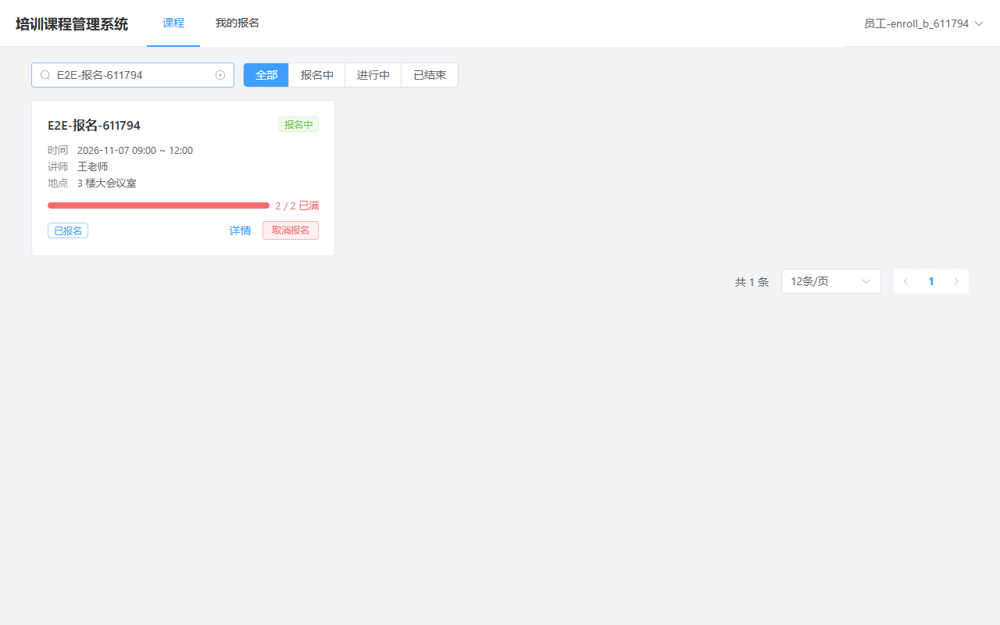
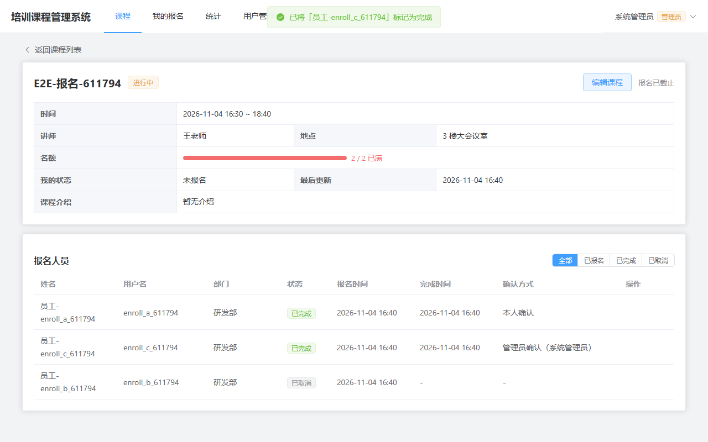
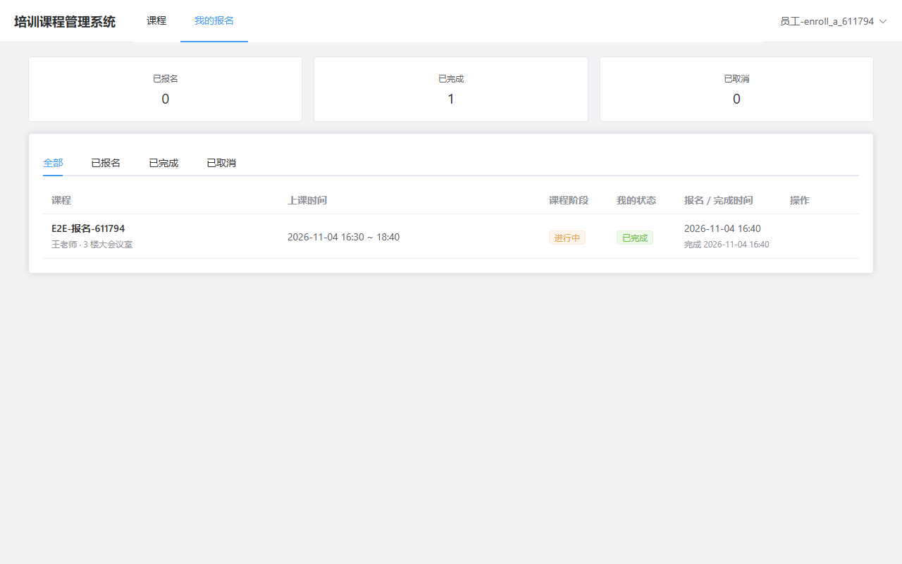
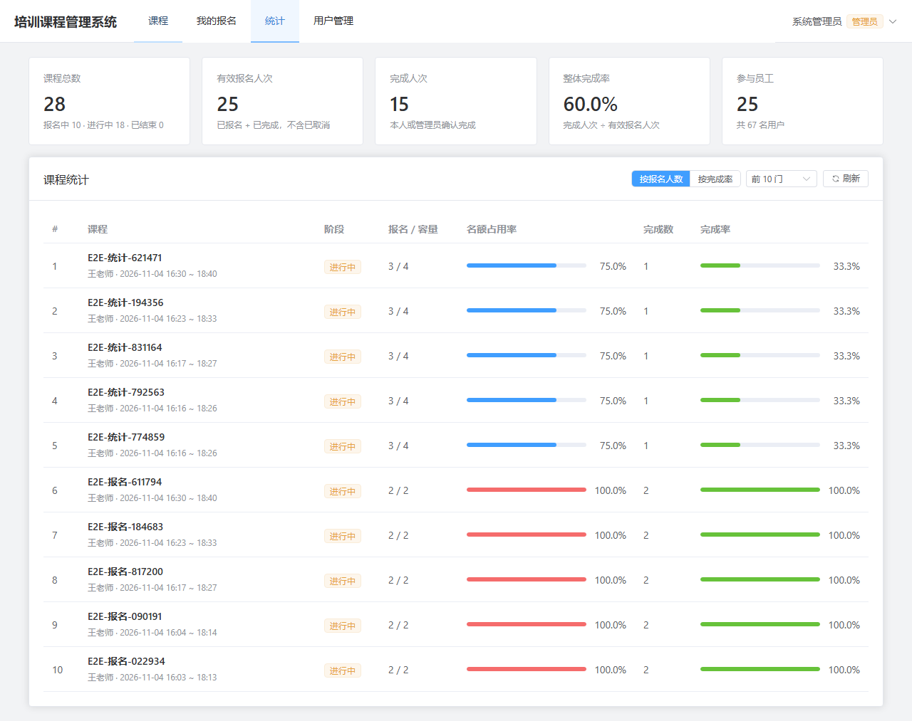

# 培训课程管理系统（TCMS）

公司内部的培训课程系统：
- **员工**：浏览课程、报名、取消报名、标记学习完成，查看自己的培训情况。
- **管理员**：维护课程、查看报名人员、代为确认完成、查看统计、管理用户。

[](https://github.com/han-cczu/TrainingCourseManagementSystem/actions/workflows/ci.yml)

| 课程列表（员工视角：已报名、已满） | 管理员：报名人员与确认方式 |
|---|---|
|  |  |
| **我的报名** | **基础统计** |
|  |  |

## 功能

| 题目需求 | 实现 |
|---|---|
| 创建课程 / 编辑课程 | 管理员操作。只能创建未来开课的课程；开课后不能再改时间和容量；容量不能改到比已报名人数少 |
| 查看课程列表 | 卡片列表，支持按课程名称或讲师搜索、按阶段（报名中 / 进行中 / 已结束）筛选、分页，并显示名额进度 |
| 用户报名课程 / 取消报名 | 只能在开课前操作；取消后可以重新报名（复用原来的记录） |
| 查看课程已报名人员 | 管理员可按状态筛选，并能看到每条完成记录是「本人确认」还是「管理员确认」 |
| 标记课程学习完成 | 开课后，员工本人或管理员都可以标记 |
| 查看我的报名 | 显示已报名、已完成、已取消的统计，并按状态分页签展示 |
| 基础统计 | 全局概览，以及按课程统计（可按报名人数或完成率排序） |
| **扩展：课程容量限制** | 满员后显示「名额已满」。后端在锁住课程行后才检查名额，并用唯一索引兜底；**20 人同时抢 5 个名额，恰好 5 人成功** |

在题目要求之外，还额外做了：
- 真实登录（JWT）：员工可自助注册，管理员可建号、停用账号、重置密码
- 开课后不能报名或取消的时间规则
- 登录限流
- Kubernetes 生产部署清单

## 技术栈

| 层 | 技术 |
|---|---|
| 前端 | Vue 3.5、TypeScript 6、Vite 8、Vue Router、Pinia、Element Plus（按需引入）、Axios |
| 后端 | Java 21、Spring Boot 4.1、Spring Security（JWT）、MyBatis-Plus 3.5、Flyway |
| 数据库 | MySQL 8.4 |
| 测试 | JUnit 5、Testcontainers（真实 MySQL）、Playwright（UI 自测）、GitHub Actions |
| 交付 | Docker（多阶段构建、非 root 运行）、docker-compose、Kubernetes（kustomize） |

## 快速开始

只需要 Docker Desktop：

```bash
docker compose -f deploy/docker-compose.yml up -d --build --wait
```

打开 **http://localhost:8000**：

| 账号 | 说明 |
|---|---|
| `admin` / `Admin12345` | 本地默认管理员（仅开发环境；生产环境的账号和密码由 Secret 注入，如果仍使用默认值，prod 配置下会拒绝启动） |
| 员工 | 在登录页点「立即注册」自助注册 |

| 其他地址 | |
|---|---|
| Swagger UI | http://localhost:8080/swagger-ui.html（先调用登录接口拿到 token，再点 Authorize 填入） |
| 健康检查 | http://localhost:8080/actuator/health |
| MySQL | `localhost:3306`，库 `tcms`，用户 `tcms` / `tcms123456`（本地开发默认值） |

停止服务：`docker compose -f deploy/docker-compose.yml down`。加上 `-v` 会同时清空数据库。

## 本地开发

```bash
# 只启动 MySQL
docker compose -f deploy/docker-compose.yml up -d mysql

# 后端（JDK 21；Maven 由 Wrapper 自动下载）
cd backend
./mvnw spring-boot:run        # Windows: .\mvnw.cmd spring-boot:run

# 前端（Node >= 22.12、pnpm 10）
cd frontend
pnpm install
pnpm dev                      # http://localhost:5173，/api 自动代理到 :8080
```

## 测试

```bash
cd backend && ./mvnw test                  # 82 个测试，Testcontainers 自动启动 MySQL（需要 Docker）
cd frontend && pnpm build                  # vue-tsc 类型检查 + 生产构建
cd e2e && npm install && npm run setup && npm run all   # 25 项 UI 自测（需先 docker compose up）
```

需求覆盖矩阵、测试用例和并发测试结果见 [自测说明](docs/自测说明.md)。每个 PR 都会由 GitHub Actions 自动运行后端测试和前端构建。

## 目录结构

```
backend/     Spring Boot 后端：按业务分包（auth、user、course、enrollment、stats）
frontend/    Vue 3 前端，以及 nginx 配置（反向代理、登录限流、安全响应头）
e2e/         Playwright UI 自测脚本
deploy/      docker-compose.yml、deploy.ps1、k8s/（kustomize：base + overlays/prod）
docs/        技术设计、实现计划、自测说明、AI Coding 使用说明、部署手册、截图
.github/     CI 工作流、PR 模板
CLAUDE.md    AI 协作约定
```

## 文档

| 文档 | 内容 |
|---|---|
| [技术设计](docs/技术设计.md) | 需求范围、数据模型、业务规则、并发控制、API、统计口径、部署、测试策略 |
| [实现计划](docs/实现计划/README.md) | 按 PR 拆分的任务清单、测试、自测步骤和完成标准（PR2~PR6） |
| [自测说明](docs/自测说明.md) | 测试环境、复现步骤、需求覆盖矩阵、UI 测试用例、并发测试结果、已知限制 |
| [AI Coding 使用说明](docs/AI-Coding使用说明.md) | 工具、协作流程、人与 AI 的分工、关键决策、AI 出过的错及纠正方式 |
| [部署手册](docs/部署手册.md) | 生产环境（火山引擎单节点 K8s）的准备、发布、回滚、备份与恢复 |

## 部署

部署目标是火山引擎云服务器上的单节点 Kubernetes。清单、发布脚本和手册都已经准备好，并通过了本地校验：kubeconform 严格模式校验、镜像在只读文件系统和非 root 用户下运行、发布脚本的演练模式。**目前暂未上线**。上线步骤见 [部署手册](docs/部署手册.md)：

```powershell
.\deploy\deploy.ps1 -Registry <镜像仓库地址>   # 或不带参数：不使用镜像仓库，直接把镜像导入服务器
```

## 开发过程

项目按 6 个 PR 交付（[#1](https://github.com/han-cczu/TrainingCourseManagementSystem/pull/1) ~ [#6](https://github.com/han-cczu/TrainingCourseManagementSystem/pull/6)）。每个 PR 都包含后端和对应的前端页面，PR 描述里附有测试结果、自测截图和 AI 使用情况。开发过程中使用了 Claude Code 辅助编码，详见 [AI Coding 使用说明](docs/AI-Coding使用说明.md)。
